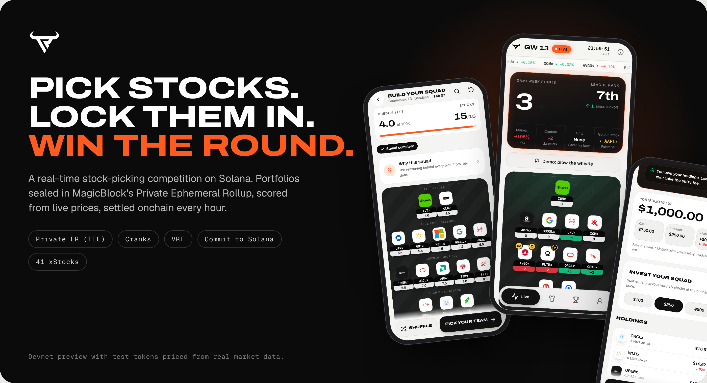
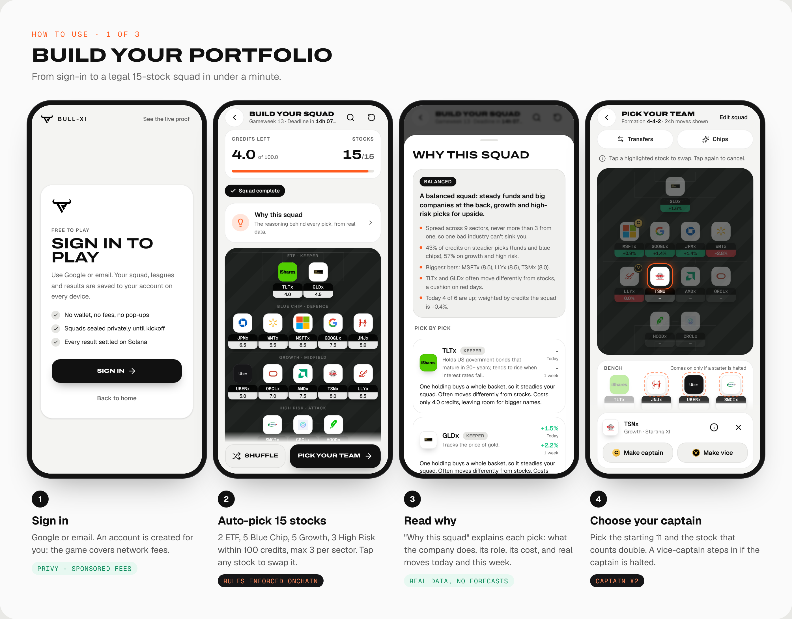
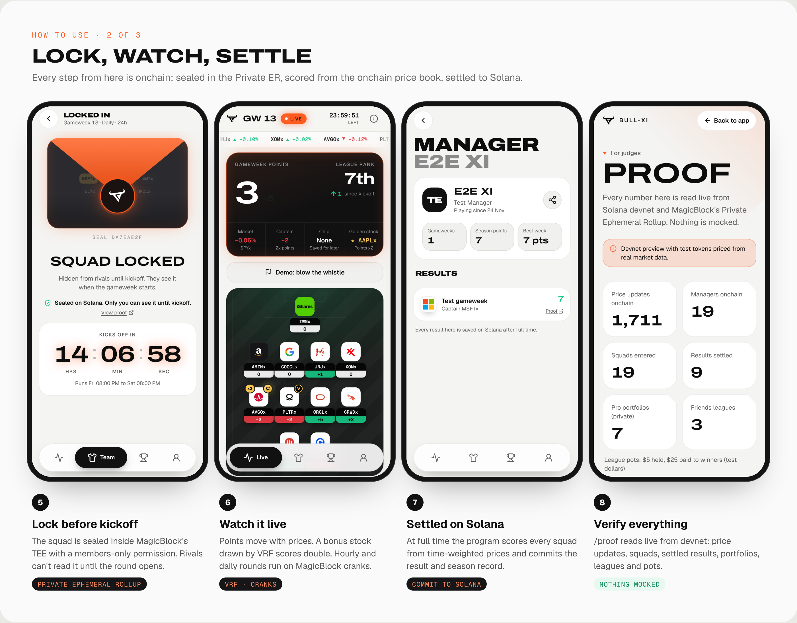
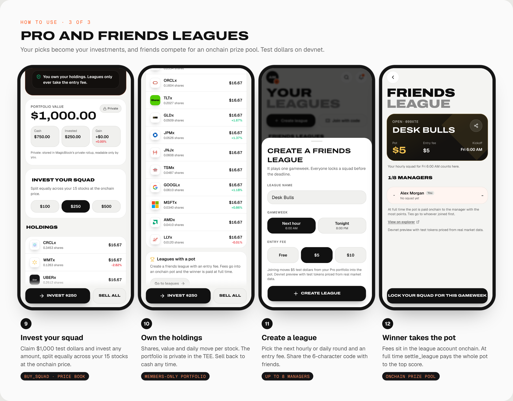
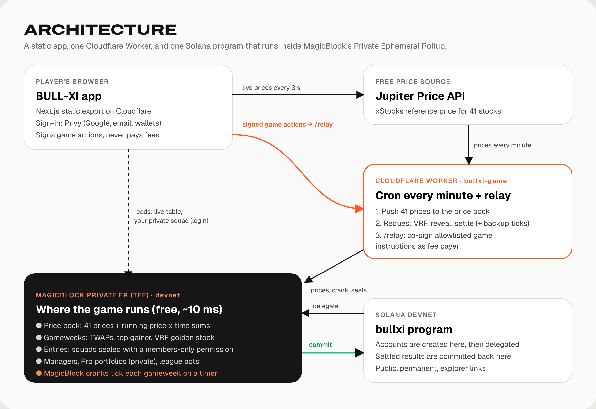
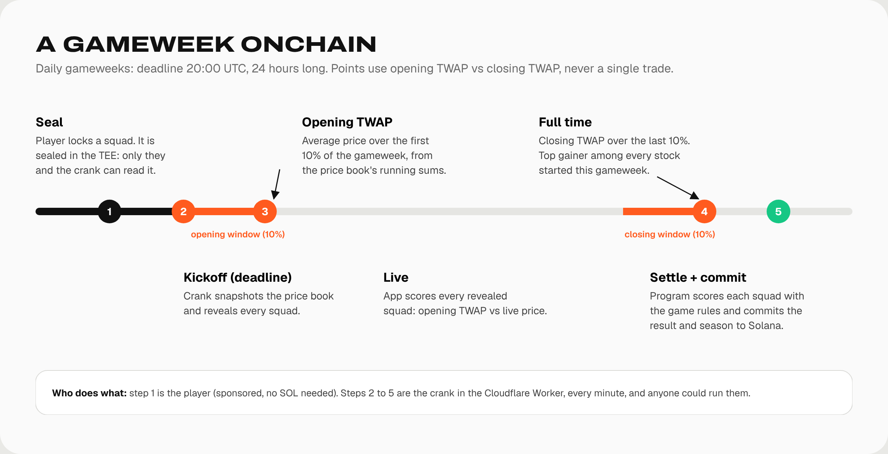
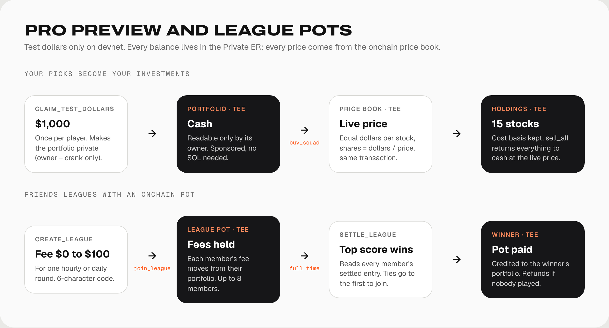
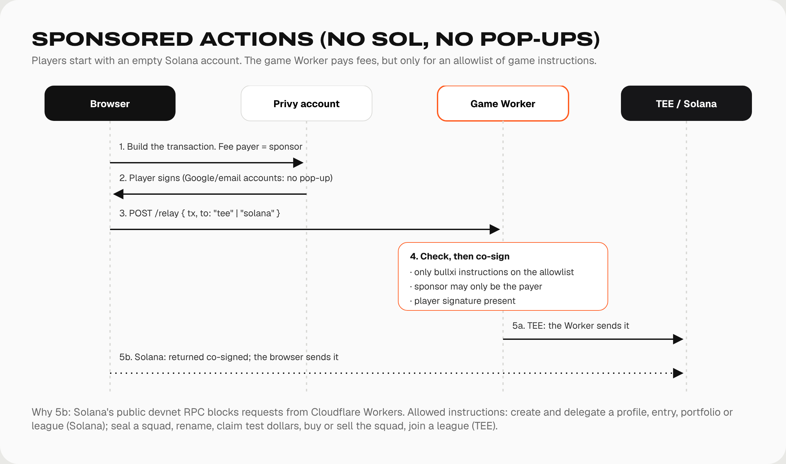

<p align="center"></p>

<h1 align="center">BULL-XI</h1>

<p align="center"><b>A real-time stock-picking competition on Solana, built on MagicBlock.</b><br/>
Build a portfolio of 15 tokenized stocks, seal it privately before the round opens, and compete on live prices. New rounds every hour, every result settled onchain.</p>

<p align="center">
<a href="https://bull-xi.timioni1490.workers.dev">Live app</a> ·
<a href="https://bull-xi.timioni1490.workers.dev/proof">Live proof</a> ·
<a href="docs/media/bullxi-film.mp4">Demo film</a> ·
<a href="https://explorer.solana.com/address/EZi2Raxa2hba9Bt5jYKf6nUkbQ4xgZeHbuBxjVJTCPXN?cluster=devnet">Program on devnet</a> ·
<a href="docs/devnet-runs/">Devnet run logs</a>
</p>

<p align="center"><sub>Built for MagicBlock Solana Blitz v10 (Entertainment Finance). Devnet preview with test tokens priced from real market data.</sub></p>

---

## Contents

1. [Overview](#overview)
2. [How to use](#how-to-use)
3. [Features](#features)
4. [MagicBlock integration](#magicblock-integration)
5. [Architecture](#architecture)
6. [How a round works](#how-a-round-works)
7. [Pro preview and league pots](#pro-preview-and-league-pots)
8. [Sponsored actions](#sponsored-actions)
9. [The program](#the-program)
10. [Verified on devnet](#verified-on-devnet)
11. [Security](#security)
12. [Live addresses](#live-addresses)
13. [Run, test and deploy](#run-test-and-deploy)
14. [Limits and roadmap](#limits-and-roadmap)
15. [Glossary](#glossary)

---

## Overview

Tokenized stocks (xStocks) trade around the clock on Solana, but most people never touch them. BULL-XI turns them into a competition anyone can follow: pick 15 stocks within a fixed budget, choose one to count double, lock the selection before the round opens, and score points from real price moves.

The app borrows the language of fantasy sports (squad, captain, gameweek) because millions of people already understand it. Under that familiar surface, every step that matters runs onchain:

| What a player sees | What happens onchain |
|---|---|
| Lock your squad | The selection is sealed inside MagicBlock's Private Ephemeral Rollup (TEE). No one else can read it until the round opens |
| Points move live | Prices are written to an onchain price book every minute; scores use time-weighted averages |
| A bonus stock is drawn | MagicBlock VRF picks it verifiably at the start of the round |
| The round ends | MagicBlock cranks advance the round; the program scores every squad and commits results to Solana |
| Go Pro | Your picks become a private portfolio of test dollars, bought at the onchain price |
| Play friends for a pot | Entry fees sit in a league account onchain and are paid to the winner at full time |

**Who it is for:** people who enjoy fantasy sports and want an approachable way into markets, and traders who want a social, competitive way to play tokenized stocks.

---

## How to use

**Try it in two minutes:** open the [live app](https://bull-xi.timioni1490.workers.dev), sign in with Google or email, tap **Auto-pick**, then **Lock squad**. Switch the deadline to **Flash** to play the hourly round.







| Step | Where in the app | What to look for |
|---|---|---|
| 1. Sign in | Any app page | Google or email. No wallet app, no SOL |
| 2. Build | Squad | **Auto-pick** builds a legal 15-stock squad; tap any stock to swap |
| 3. Understand | Squad, **Why this squad** | A rationale for each pick from real data, no forecasts |
| 4. Captain | Pick team | Starting 11, captain (x2) and vice-captain |
| 5. Lock | Deadline | **Sealed on Solana** within seconds, with an explorer link |
| 6. Watch | Live | Live points, league rank, the VRF bonus stock (★) |
| 7. Results | Profile, History | Scores settled and committed to Solana |
| 8. Verify | `/proof` | Live onchain counters, the current round, addresses |
| 9. Pro | Profile, **Go Pro** | Claim $1,000 test dollars, **Invest $250**, see holdings |
| 10. Leagues | Leagues, **Create league** | Choose a round and entry fee, share the 6-character code |

Short on time? Add `?demo=1` to the app URL for a 10x replay of a round with a simulated league.

---

## Features

**Competition**
- **Rounds every hour and every day.** Hourly flash rounds and a daily round (20:00 UTC) run onchain, so a full cycle fits in an hour.
- **41 real stocks.** xStocks priced from the xStocks reference price (Jupiter Price API, free). The app refreshes every 3 seconds.
- **Rules enforced onchain.** 15 stocks (2 ETF, 5 Blue Chip, 5 Growth, 3 High Risk), 100 credits, max 3 per sector, legal formation, captain and vice. Scoring (time-weighted move x 10, caps, captain, chips, bonuses, auto-subs) runs in the program and is mirrored in TypeScript with parity tests.
- **Bonus stock (VRF).** At the start of each round MagicBlock VRF draws one of the stocks started that round; it scores double for everyone holding it.
- **Live table.** During a round the app scores every revealed squad from the onchain opening price and live prices, the same maths as settlement.

**Guidance**
- **Why this squad.** Auto-pick uses real signals only (today's price move, sector spread, budget fit). A rationale sheet explains each pick: what the company does, its role, its cost, and real moves today and this week. It is explicit that it is not financial advice.

**Pro preview and leagues**
- **Your picks become your investments.** Claim $1,000 of test dollars and invest any amount, split equally across your 15 stocks at the onchain price. The portfolio lives privately in the TEE. Sell back to cash any time.
- **Friends leagues with an onchain pot.** Create a league for the next hourly or daily round with a $0, $5 or $10 entry fee and share a 6-character code. At full time the program pays the pot to the top score.

**Access**
- **Sign in with Google or email.** Privy creates a Solana account automatically and signs game actions in the background. A sponsored relay pays network fees for an allowlist of game instructions, so players never need SOL or a wallet app.
- **Fits any screen.** Designed for phones (390 px) and checked from 320 px phones to 1920 px monitors.

---

## MagicBlock integration

Every piece is load-bearing and live on devnet.

| Need | MagicBlock technology | Status |
|---|---|---|
| Squads hidden until the round opens | Private Ephemeral Rollup (TEE) + members-only permission | Live |
| Private portfolios and league pots | Private Ephemeral Rollup (TEE) + members-only permission | Live |
| Prices and time-weighted scoring | Price book on the Private ER, written every minute | Live |
| Bonus stock draw | VRF (scoped callback identity, ephemeral queue) | Live |
| Round snapshots on a timer | Cranks (ScheduleTask on the rollup) | Live |
| Results on Solana | Commit from the rollup | Live |
| Reveal and settlement | Permissionless instructions, Worker crank as backup | Live |
| Prize payouts as onchain actions | Magic Actions | Planned |
| Real-money entry fees | Ephemeral SPL Token / Private Payments | Planned |
| Season badges | SOAR | Planned |

Everything game-related lives on **one rollup (the TEE)**, so a single transaction can read a squad, the round and the price book together. Why our own price book: MagicBlock's pricing oracle only accepts its own signer, and its public feed list has no equities.

---

## Architecture



| Part | Where | What it does |
|---|---|---|
| **App** | Cloudflare Workers Static Assets (`wrangler.jsonc`) | Next.js static export. No server code. Talks to Jupiter, the Worker, devnet and the TEE directly |
| **Game Worker** | Cloudflare Worker `bullxi-game` (`worker/`) | Cron every minute: push prices, snapshot rounds, request VRF, reveal, settle, pay league pots. `POST /relay` co-signs allowlisted game transactions |
| **bullxi program** | Solana devnet, accounts delegated to the MagicBlock TEE (`onchain/`) | Price book, rounds, sealed entries, managers, portfolios, leagues, scoring, settlement |
| **Sign-in** | Privy (free tier) | Google and email accounts get a Solana key automatically; Phantom, Solflare and Backpack also work |

Total infrastructure cost: **$0** (Cloudflare free tier, Solana devnet, MagicBlock devnet, free price API).

---

## How a round works



1. **Seal.** The app creates the player's profile and entry on Solana (sponsored), delegates them to the TEE, then seals the squad there. A permission lets only the player and the crank read it.
2. **Kickoff.** At the deadline a MagicBlock crank snapshots the price book, squads are revealed, and MagicBlock VRF draws the bonus stock.
3. **Opening price.** After the first 10% of the round, the time-weighted average price per stock is fixed.
4. **Full time.** The closing average is fixed over the last 10%, and the program finds the top gainer among every stock started that round.
5. **Settle and commit.** Each squad is scored with `game.rs` and committed to Solana with the manager's updated season. League pots are paid out.

Daily rounds have a 20:00 UTC deadline and last 24 hours; flash rounds start every hour and last one. Every step is permissionless.

### The price book


One 1.6 KB account holds the latest price of every stock and a running `price x seconds` sum. Any window's time-weighted average is `(cum_end - cum_start) / (t_end - t_start)`, so a 24-hour round needs only four snapshots.

---

## Pro preview and league pots



- **Portfolio.** `claim_test_dollars` credits $1,000 once and makes the portfolio private (owner and crank only). `buy_squad` splits any amount equally across the 15 stocks at the live price-book price in the same transaction and records the cost basis. `sell_all` returns everything to cash at the live price.
- **League.** `create_league` sets the round, name and entry fee (up to $100). `join_league` moves the fee from the member's portfolio into the league account before the deadline (up to 8 members). After full time, `settle_league` reads every member's settled entry and pays the whole pot to the top score; ties go to the first to join, and fees are refunded if nobody played.

All amounts are test dollars on devnet, priced from real market data. Real money is the next milestone (see [Limits and roadmap](#limits-and-roadmap)).

---

## Sponsored actions



The relay only co-signs these instructions, and the sponsor may only appear as the fee payer:

| Where | Allowed |
|---|---|
| Solana | `create_manager`, `delegate_manager`, `create_entry`, `delegate_entry`, `create_portfolio`, `delegate_portfolio`, `create_league`, `delegate_league` |
| TEE | `seal_entry`, `set_profile`, `claim_test_dollars`, `buy_squad`, `sell_all`, `join_league` |

Solana's public devnet RPC blocks Cloudflare Workers, so Solana-side transactions are returned co-signed and the browser sends them.

---

## The program

`onchain/programs/bullxi` (Anchor 1.x, `ephemeral-rollups-sdk` 0.17 with `access-control`).

| Account | Seeds | Lives on | Holds |
|---|---|---|---|
| `PriceBook` | `price_book` | TEE | 48 price slots (micro-USD), running TWAP sums, pusher key |
| `Config` | `config` | Solana | Admin and crank keys |
| `Gameweek` | `gameweek_v3`, id | TEE | Deadline, end, window, opening and closing TWAP, picked stocks, top gainer, VRF golden stock |
| `Entry` | `entry`, gameweek, player | TEE (private until kickoff) | Squad, XI, bench, captain, vice, chip, points |
| `Manager` | `manager`, player | TEE, committed to Solana | Name, team, gameweeks, season points, best week |
| `Portfolio` | `portfolio`, player | TEE (private: player + crank only) | Test-dollar cash, cost basis, micro-shares of each stock |
| `League` | `league`, id | TEE | Name, gameweek, entry fee, pot, up to 8 members, winner, amount paid out |

| Instruction | Who | Layer |
|---|---|---|
| `push_prices`, `commit_price_book` | Pusher | TEE |
| `create_gameweek`, `delegate_gameweek` | Admin or crank | Solana |
| `create_manager`, `delegate_manager`, `create_entry`, `delegate_entry` | Player (sponsored) | Solana |
| `seal_entry`, `set_profile` | Player (sponsored) | TEE |
| `snapshot_gameweek`, `tick_gameweek` | Anyone, or a MagicBlock crank (`schedule_ticks`) | TEE |
| `request_golden` → `golden_callback` | Anyone after kickoff → MagicBlock VRF (scoped identity only) | TEE |
| `reveal_entry`, `settle_entry` | Anyone after the right time (crank) | TEE |
| `create_portfolio`, `delegate_portfolio`, `create_league`, `delegate_league` | Player (sponsored) | Solana |
| `claim_test_dollars`, `buy_squad`, `sell_all`, `join_league` | Player (sponsored) | TEE |
| `settle_league` | Anyone after full time (crank) | TEE |

Rules live in `onchain/programs/bullxi/src/game.rs` and mirror `lib/game/rules.ts`. Both are unit tested, and `scripts/onchain/live-check.ts` checks that the app's live score equals the onchain settled score.

---

## Verified on devnet

Two full end-to-end runs with every signature: [game loop](docs/devnet-runs/2026-11-24-e2e-v3.md) and [Pro + friends leagues](docs/devnet-runs/2026-11-26-pro-leagues.md).

| Check | Result | Evidence |
|---|---|---|
| Sponsored join and entry (player has 0 SOL) | Pass | [create + delegate profile](https://explorer.solana.com/tx/zuKBxvBZjijLdFopUfWSrn8iVyF5S7BnLDQoWW7VpskorHVU4zGYABbdcFDKHYisD5S8zEmpuvsQggYocbVgUsP?cluster=devnet) · [create + delegate entry](https://explorer.solana.com/tx/3hcwR3bvFBBpVx29doFLJsM251aSfh9SX1f56SQjGiqnZMiFwSiTij2i7oAMbWPdeWivGjPtcs9BSxumzLG7EjEZ?cluster=devnet) |
| MagicBlock crank scheduled on the TEE | Pass | [schedule_ticks](https://explorer.solana.com/tx/3iFAYo9bfupcFdw2QToUupBUB6SMtoetg9D3oDLrdVQbogS2h6EXayATnFdsAUzvHpaFEchghBuR39iZxerQvCnr?cluster=custom&customUrl=https%3A%2F%2Fdevnet-tee.magicblock.app) |
| Squad sealed in the TEE | Pass | [seal_entry](https://explorer.solana.com/tx/4UjTYPPF5V81LhVd55pvsuayLvub7SS6mEGYYXCghznh1AHznz6GauMdNrtkvNj65uCsJ2EGofQVm4qThpJgtWhX?cluster=custom&customUrl=https%3A%2F%2Fdevnet-tee.magicblock.app) |
| Stranger can't read the sealed squad; player can | Pass | log, before kickoff |
| Kickoff, live, closing and final advanced by the MagicBlock crank alone | Pass | log, 4 of 4 steps |
| Golden stock drawn by MagicBlock VRF (callback landed: UNHx) | Pass | [request_golden](https://explorer.solana.com/tx/4xMXxc1B4cjFpR9BZ2LoEzuemkT96gGeK7fG3GeGy4oD26zgoy2nuBcHQydmM3sZ9YfEtnEFVxkZMALSgTtXCteA?cluster=custom&customUrl=https%3A%2F%2Fdevnet-tee.magicblock.app) |
| Squad public after kickoff | Pass | [reveal_entry](https://explorer.solana.com/tx/5YjTEhunDLjdSz35gwHLQ71UaxzSh5nPv7cy1nHhVtgUdVm8JPD6aCvj7qvKeLmRAjPUhjYc8nHbCKbqCgEZZhPK?cluster=custom&customUrl=https%3A%2F%2Fdevnet-tee.magicblock.app) |
| Settled onchain (7 pts) and committed to Solana | Pass | [settle](https://explorer.solana.com/tx/23fdvXkWVGK7MFc2FprDr2cgrug6a9w1Lk3JS9Uq2nncFDSc6AxwvEsmbvzMCfewbk7u9DC5CwzAqdsjqwDtyFmi?cluster=custom&customUrl=https%3A%2F%2Fdevnet-tee.magicblock.app) · [manager on Solana](https://explorer.solana.com/address/961VZjtTUfDnYjJZpqQF63nLTwzt2spoPFMEHDP6v9yc?cluster=devnet) · [entry on Solana](https://explorer.solana.com/address/yHfYFccD14oQUdNPAXrhmhV85gu8ujuxS9QswcSv3zQ?cluster=devnet) |
| App live score equals onchain settled score | Pass | `scripts/onchain/live-check.ts` |
| A browser seals from the app in ~8 s with no wallet or SOL (device-key path) | Pass | Playwright run, demo video |
| Sign-in is required before playing (Google or email via Privy) | Pass | Playwright: gate shown, Privy modal opens |
| Pro portfolio opened for a player with 0 SOL (sponsored) | Pass | [create + delegate portfolio](https://explorer.solana.com/tx/gjD718bovb4fvZH96basJcfxGVuo17nEd9PGz2NnuqPxYHt8ATH25CrZd8n3wSoAFAFKD3UfgH1GGLEa3jF2Gos?cluster=devnet) |
| $1,000 test dollars claimed; portfolio made private | Pass | [claim_test_dollars](https://explorer.solana.com/tx/2YEPBMwfYAYFXMp8QG8FkwY3tZ6M9dgVX6EsJ3132NPSRzYeUfsDZWDFZwzH7b6Xu9Bx8LEDxazSDdrUJvkF7C5W?cluster=custom&customUrl=https%3A%2F%2Fdevnet-tee.magicblock.app) |
| $300 invested equally across a 15-stock squad at the onchain price | Pass | [buy_squad](https://explorer.solana.com/tx/4e7v4WJ1RE3gfrXQodnKzxAKzTXkwCcmnu9DDfykK4PSffif9mwCEasBbsXHDUTqMsVmRUPzuJBeh2yW1TP6Jgi4?cluster=custom&customUrl=https%3A%2F%2Fdevnet-tee.magicblock.app) |
| Stranger can't read a Pro portfolio | Pass | log |
| $10 friends league: two players join, pot $20 held onchain | Pass | [join A](https://explorer.solana.com/tx/3RcxGcsroqHDcdcq9VJXhFzGBJeMLgcf8LYYnx852RoreGo3brk9XJakxKZGsaz96eW3nPdyB9zDjG2aaqqVs2uB?cluster=custom&customUrl=https%3A%2F%2Fdevnet-tee.magicblock.app) · [join B](https://explorer.solana.com/tx/5cRcatPctsfUAH4wha6dX3QLnsx4P4c6tD8A99PyPBKjBfbRsPGznug9j9XPRuDXnEEuvR2Q8pxDNd4gvwWrhZcr?cluster=custom&customUrl=https%3A%2F%2Fdevnet-tee.magicblock.app) |
| Pot paid to the winner's portfolio at full time ($990 to $1,010) | Pass | [settle_league](https://explorer.solana.com/tx/2pmbK77LDXemXZd6JsyfcujNDHpmHbUjxNZspzvU5L48ijVfYa6H6gCRwQRxyL83SrHCNTtLZKbKJmxXp7DYm8y5?cluster=custom&customUrl=https%3A%2F%2Fdevnet-tee.magicblock.app) |
| Same flows from the app UI (claim, invest, create a $5 league) | Pass | Playwright recording, demo film |

---

## Security

| Risk | Mitigation |
|---|---|
| Copying a rival's squad before kickoff | Squads live in the TEE with a members-only permission (player + crank). Base-layer accounts never hold the squad before kickoff |
| Draining the fee sponsor | `/relay` co-signs only 14 game instructions, the sponsor may only be the fee payer, max 4 instructions, player signature required. Devnet-only key |
| Forged VRF result | `#[vrf_callback]` only accepts our program's scoped VRF identity; a duplicate callback has no effect |
| Gaming the price with one trade | Points use time-weighted average prices over 10% windows, from a price book written every minute |
| Crank going down | Every step is permissionless: MagicBlock cranks, the Worker, or anyone can advance it. Cranks are armed per gameweek |
| Illegal squads via direct calls | Squad, budget, sector, formation and captain rules are enforced in `seal_entry`, not only in the app |
| Spending someone else's test dollars | `buy_squad`, `sell_all` and `join_league` require the portfolio owner's signature (PDA seeded by the signer); `settle_league` checks every entry and portfolio address against its seeds and can only credit league members |
| Peeking at holdings | Portfolios sit in the TEE with a members-only permission (owner + crank) |
| Price source | One source (xStocks reference price via Jupiter). Mainnet would add a second source and sanity bounds |

---

## Live addresses

| What | Address |
|---|---|
| Program | [`EZi2Raxa2hba9Bt5jYKf6nUkbQ4xgZeHbuBxjVJTCPXN`](https://explorer.solana.com/address/EZi2Raxa2hba9Bt5jYKf6nUkbQ4xgZeHbuBxjVJTCPXN?cluster=devnet) |
| Price book | [`3QmqpfrpbsTU6J4t8vjhFHr8BZo5yczp6C8zZFnRE7pK`](https://explorer.solana.com/address/3QmqpfrpbsTU6J4t8vjhFHr8BZo5yczp6C8zZFnRE7pK?cluster=devnet) |
| Game config | [`5orhWwHuxps7KWzsbCrNKdo9dYFMjvc9WkzcH6dKjQxk`](https://explorer.solana.com/address/5orhWwHuxps7KWzsbCrNKdo9dYFMjvc9WkzcH6dKjQxk?cluster=devnet) |
| TEE validator | `MTEWGuqxUpYZGFJQcp8tLN7x5v9BSeoFHYWQQ3n3xzo` (`devnet-tee.magicblock.app`) |

`/proof` in the app reads these live: price updates, managers, squads, settled results, portfolios, leagues, pots and the current round.

---

## Run, test and deploy

### Run locally

```bash
npm install
npm run dev              # http://localhost:3000
npm run check            # lint + typecheck + tests + static build
```

| Switch | Effect |
|---|---|
| `?demo=1` | Simulated market, 10x faster, plus "start now" and "blow the whistle" buttons |
| `?mock=sim` | Simulated market at normal speed |
| `?mock=slow` / `error` / `empty` | Loading, error and empty states |
| `NEXT_PUBLIC_PRIVY_APP_ID=off` | Build without sign-in |

### Onchain scripts

```bash
npm run onchain:test           # Rust tests: price book maths and every game rule
npm run onchain:build          # cargo build-sbf --arch v0
npm run onchain:gen            # regenerate the stock table (universe.rs) from the app's list
npm run onchain:client         # regenerate the typed @solana/kit client from the IDL (Codama)
npm run onchain:schedule -- 8  # create the next 8 daily gameweeks
npm run onchain:crank          # what the Worker cron does, locally (add -- --loop)
npm run onchain:read           # price book on the TEE and on Solana
npx tsx scripts/onchain/e2e.ts         # 5-minute round end to end: seal, privacy, reveal, TWAP, settle, commit
npx tsx scripts/onchain/pro-e2e.ts     # Pro + friends league end to end: portfolios, buy, pot, payout
npx tsx scripts/onchain/live-check.ts  # app live score vs onchain settled score
```

### Deploy (Cloudflare dashboard, no local machine needed)

**1. Web app.** Workers & Pages → Create → Import a repository → this repo.
Branch `main`, build command `npm run build`, deploy command `npx wrangler deploy`, variable `NODE_VERSION=22`, project name `bull-xi` (must match `wrangler.jsonc`).

**2. Game Worker.** Workers & Pages → Create → Import a repository → this repo again.
Project name **`bullxi-game`** (must match `worker/wrangler.jsonc`), build command empty, deploy command `npx wrangler deploy --config worker/wrangler.jsonc`, variable `NODE_VERSION=22`.

**3. Its key.** Open `bullxi-game` → Settings → Variables and Secrets → Add → type **Secret**, name `PUSHER_KEY`, value = the `[12,34,...]` line of the pusher key. Save, then Deployments → Retry deployment.

**4. Check.** `https://bullxi-game.timioni1490.workers.dev/health` shows `"ok": true` within two minutes. The app expects the Worker at that URL (`GAME_API` in `lib/config.ts`).

From a terminal instead: `npx wrangler login`, `npm run deploy:web`, `npx wrangler secret put PUSHER_KEY --config worker/wrangler.jsonc`, `npm run deploy:worker`.

#### Keys (devnet only)

| Key | Role |
|---|---|
| `deployer` `6hxtk7…Y3uT` | Program upgrade authority, admin of the price book and config |
| `pusher` `NdtGUb…BgrWy` | The Worker's key: price pusher, crank, fee sponsor (`PUSHER_KEY`) |
| `program` | Program address keypair |

Keys never go in the repo. Scripts read them from `~/.config/solana/bullxi/` (or `BULLXI_KEYS_DIR`).

### Repo map

```
app/, components/        Next.js app (static export)
lib/data/                the only data API the UI uses (live prices, onchain play, simulated mode)
lib/onchain/             @solana/kit clients: generated program client, game, crank, relay checks, TEE login
lib/game/rules.ts        game rules (TypeScript), unit tested
lib/auth/                sign-in context; Privy behind it
worker/                  game Worker: cron + /relay + /health + /price-book
onchain/programs/bullxi  Anchor program; src/game.rs mirrors rules.ts
scripts/onchain/         deploy, schedule, crank, e2e and inspection scripts
docs/                    diagrams (docs/diagrams, rendered to docs/images), stock list
```

The demo film is made in code with Remotion from real app recordings: see [`video/README.md`](video/README.md). README visuals are rendered from `docs/diagrams/` with `node scripts/docs/render-diagrams.mjs`; screenshots come from `scripts/docs/capture-screens.cjs`.

---

## Limits and roadmap

**Current limits**
- Devnet only. Mainnet is a one-line change in `lib/config.ts` (`NETWORK`), plus real funding.
- One price source (xStocks reference price via Jupiter). Mainnet would add a second source and sanity bounds.
- Rounds are created ahead from a script (the Worker can't write to Solana's public devnet RPC): daily through Dec 2, hourly for three days at a time.
- With a plain payer the rollup allows 10 commits per delegated account, so each manager can settle 10 rounds before re-delegation.
- The relay sees a squad when it forwards the seal (like the crank). Other players cannot.
- Pro uses test dollars held as balances in the portfolio account, not tokens.

**Next**
1. Real-money Pro: USDC deposits buying real xStocks into a vault the player owns, with identity checks and country rules where required.
2. Entry fees and payouts as SPL tokens through Ephemeral SPL Token and Magic Actions.
3. Session keys for in-round changes, SOAR season badges, and a second price source.

---

## Glossary

| Term | Plain English |
|---|---|
| xStock | A tokenized share that tracks a real stock (NVDAx tracks Nvidia) |
| TWAP | Time-weighted average price: the average over a window, so one odd trade can't swing points |
| Ephemeral Rollup (ER) | A fast, free MagicBlock runtime that takes over Solana accounts for a while and commits results back |
| Private ER / TEE | An ER running in secure hardware; accounts can be readable only by chosen members |
| VRF | Verifiable randomness: a random number anyone can check wasn't rigged |
| Crank | A scheduled task that calls a program on a timer |
| Commit | Writing the rollup's latest state back to Solana |
| Test dollars | Devnet-only play money in a Pro portfolio, priced from real market data. Not real money |

---

<sub>BULL-XI is a devnet preview. Test tokens and test dollars have no monetary value. Past results don't guarantee future returns. You can lose money when investing for real.</sub>
