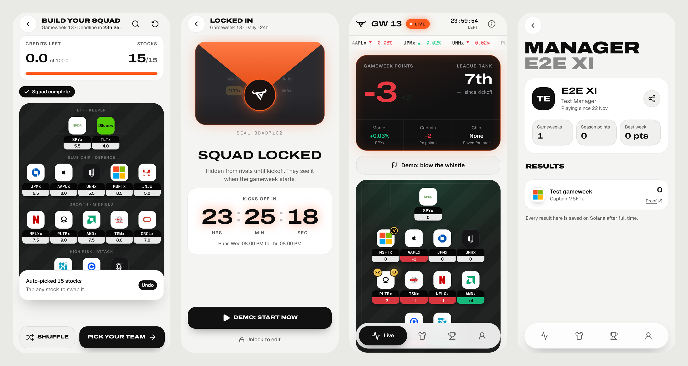
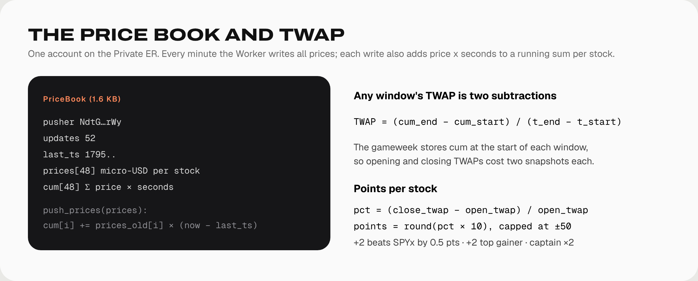

# BULL-XI

**A fantasy league for tokenized stocks, running on Solana and MagicBlock's Private Ephemeral Rollup.**
Players pick 15 real stocks (xStocks), seal their squad privately before the deadline, and are scored onchain from time-weighted prices. Results are committed to Solana.

Built for MagicBlock Solana Blitz v10. Runs on **devnet**: test SOL, real market prices, $0 infrastructure.



| | |
|---|---|
| App | `https://bullxi.timioni1490.workers.dev` |
| Proof page (live devnet numbers) | `/proof` |
| Program (devnet) | [`EZi2Raxa2hba9Bt5jYKf6nUkbQ4xgZeHbuBxjVJTCPXN`](https://explorer.solana.com/address/EZi2Raxa2hba9Bt5jYKf6nUkbQ4xgZeHbuBxjVJTCPXN?cluster=devnet) |

---

## What it does

- **Real prices.** 41 xStocks priced from the xStocks reference price (Jupiter API, free). The app polls every 3 s; a Worker writes the same prices onchain every minute.
- **Sealed squads.** A locked squad lives in MagicBlock's **Private ER (TEE)** with a members-only permission. Rivals can't read it until kickoff.
- **Onchain rules and scoring.** Squad rules (15 stocks, 2/5/5/3, 100 credits, max 3 per sector, formation, captain) and scoring (TWAP move, captain, chips, bonuses, auto-subs) run in the program.
- **Settlement on Solana.** At full time each squad is scored and the result plus the manager's season record are committed to Solana.
- **No SOL, no pop-ups.** Players sign in with Google or email (Privy). A sponsor key pays fees for an allowlist of game instructions only.
- **Live table.** During a gameweek the app scores every revealed squad from the onchain opening TWAP and live prices, the same maths as settlement.
- **Guest mode.** Without signing in, the full game works locally with a simulated league.

---

## Architecture


| Part | Where | What it does |
|---|---|---|
| **App** | Cloudflare Workers Static Assets (`wrangler.jsonc`) | Next.js static export. No server code. Talks to Jupiter, the Worker, devnet and the TEE directly |
| **Game Worker** | Cloudflare Worker `bullxi-game` (`worker/`) | Cron every minute: push prices, snapshot TWAPs, reveal, settle. `POST /relay` co-signs allowlisted game transactions |
| **bullxi program** | Solana devnet, accounts delegated to the MagicBlock TEE (`onchain/`) | Price book, gameweeks, sealed entries, managers, scoring, settlement |
| **Sign-in** | Privy (free tier) | Google and email accounts get a Solana key automatically; Phantom, Solflare and Backpack also work |

Everything game-related lives on **one rollup (the TEE)** so a single transaction can read a squad, the gameweek and the price book together.

---

## A gameweek onchain


1. **Seal.** The app creates the player's profile and entry on Solana (sponsored), delegates them to the TEE, then seals the squad there. A permission lets only the player and the crank read it.
2. **Kickoff.** At the deadline the crank snapshots the price book and reveals every squad.
3. **Opening TWAP.** After the first 10% of the gameweek, the average price per stock is fixed.
4. **Full time.** The closing TWAP is fixed over the last 10%, and the program finds the top gainer among every stock started that week.
5. **Settle and commit.** Each squad is scored with `game.rs` and committed to Solana with the manager's updated season.

Daily gameweeks have a 20:00 UTC deadline and last 24 hours. The crank (steps 2 to 5) is permissionless in design: anyone could call it.

### The price book and TWAP



One 1.6 KB account holds the latest price of every stock and a running `price x seconds` sum. Any window's TWAP is `(cum_end - cum_start) / (t_end - t_start)`, so a 24-hour gameweek needs only four snapshots.

### Sponsored actions


The relay only co-signs these instructions, and the sponsor may only appear as the fee payer:

| Where | Allowed |
|---|---|
| Solana | `create_manager`, `delegate_manager`, `create_entry`, `delegate_entry` |
| TEE | `seal_entry`, `set_profile` |

Solana's public devnet RPC blocks Cloudflare Workers, so Solana-side transactions are returned co-signed and the browser sends them.

---

## The program

`onchain/programs/bullxi` (Anchor 1.x, `ephemeral-rollups-sdk` 0.17 with `access-control`).

| Account | Seeds | Lives on | Holds |
|---|---|---|---|
| `PriceBook` | `price_book` | TEE | 48 price slots (micro-USD), running TWAP sums, pusher key |
| `Config` | `config` | Solana | Admin and crank keys |
| `Gameweek` | `gameweek_v2`, id | TEE | Deadline, end, window, opening and closing TWAP, picked stocks, top gainer |
| `Entry` | `entry`, gameweek, player | TEE (private until kickoff) | Squad, XI, bench, captain, vice, chip, points |
| `Manager` | `manager`, player | TEE, committed to Solana | Name, team, gameweeks, season points, best week |

| Instruction | Who | Layer |
|---|---|---|
| `push_prices`, `commit_price_book` | Pusher | TEE |
| `create_gameweek`, `delegate_gameweek` | Admin or crank | Solana |
| `create_manager`, `delegate_manager`, `create_entry`, `delegate_entry` | Player (sponsored) | Solana |
| `seal_entry`, `set_profile` | Player (sponsored) | TEE |
| `snapshot_gameweek`, `reveal_entry`, `settle_entry` | Anyone after the right time (crank) | TEE |

Rules live in `onchain/programs/bullxi/src/game.rs` and mirror `lib/game/rules.ts`. Both are unit tested, and `scripts/onchain/live-check.ts` checks that the app's live score equals the onchain settled score.

---

## Live on devnet


| What | Address |
|---|---|
| Program | [`EZi2Raxa2hba9Bt5jYKf6nUkbQ4xgZeHbuBxjVJTCPXN`](https://explorer.solana.com/address/EZi2Raxa2hba9Bt5jYKf6nUkbQ4xgZeHbuBxjVJTCPXN?cluster=devnet) |
| Price book | [`3QmqpfrpbsTU6J4t8vjhFHr8BZo5yczp6C8zZFnRE7pK`](https://explorer.solana.com/address/3QmqpfrpbsTU6J4t8vjhFHr8BZo5yczp6C8zZFnRE7pK?cluster=devnet) |
| Game config | [`5orhWwHuxps7KWzsbCrNKdo9dYFMjvc9WkzcH6dKjQxk`](https://explorer.solana.com/address/5orhWwHuxps7KWzsbCrNKdo9dYFMjvc9WkzcH6dKjQxk?cluster=devnet) |
| TEE validator | `MTEWGuqxUpYZGFJQcp8tLN7x5v9BSeoFHYWQQ3n3xzo` (`devnet-tee.magicblock.app`) |

`/proof` in the app reads these live: price updates, managers, squads, settled results and today's gameweek.

---

## Deploy (Cloudflare dashboard, no local machine needed)

**1. Web app.** Workers & Pages → Create → Import a repository → this repo.
Branch `main`, build command `npm run build`, deploy command `npx wrangler deploy`, variable `NODE_VERSION=22`, project name `bullxi`.

**2. Game Worker.** Workers & Pages → Create → Import a repository → this repo again.
Project name **`bullxi-game`** (must match `worker/wrangler.jsonc`), build command empty, deploy command `npx wrangler deploy --config worker/wrangler.jsonc`, variable `NODE_VERSION=22`.

**3. Its key.** Open `bullxi-game` → Settings → Variables and Secrets → Add → type **Secret**, name `PUSHER_KEY`, value = the `[12,34,...]` line of the pusher key. Save, then Deployments → Retry deployment.

**4. Check.** `https://bullxi-game.timioni1490.workers.dev/health` shows `"ok": true` within two minutes. The app expects the Worker at that URL (`GAME_API` in `lib/config.ts`).

From a terminal instead: `npx wrangler login`, `npm run deploy:web`, `npx wrangler secret put PUSHER_KEY --config worker/wrangler.jsonc`, `npm run deploy:worker`.

### Keys (devnet only)

| Key | Role |
|---|---|
| `deployer` `6hxtk7…Y3uT` | Program upgrade authority, admin of the price book and config |
| `pusher` `NdtGUb…BgrWy` | The Worker's key: price pusher, crank, fee sponsor (`PUSHER_KEY`) |
| `program` | Program address keypair |

Keys never go in the repo. Scripts read them from `~/.config/solana/bullxi/` (or `BULLXI_KEYS_DIR`).

---

## Run locally

```bash
npm install
npm run dev              # http://localhost:3000
npm run check            # lint + typecheck + tests + static build
```

| Switch | Effect |
|---|---|
| `?demo=1` | Simulated market, 10x faster, plus "start now" and "blow the whistle" buttons |
| `?mock=sim` | Simulated market at normal speed |
| `?mock=slow` / `error` / `empty` | Loading, error and empty states |
| `NEXT_PUBLIC_PRIVY_APP_ID=off` | Build without sign-in |

## Onchain scripts

```bash
npm run onchain:test           # Rust tests: price book maths and every game rule
npm run onchain:build          # cargo build-sbf --arch v0
npm run onchain:gen            # regenerate the stock table (universe.rs) from the app's list
npm run onchain:client         # regenerate the typed @solana/kit client from the IDL (Codama)
npm run onchain:schedule -- 8  # create the next 8 daily gameweeks
npm run onchain:crank          # what the Worker cron does, locally (add -- --loop)
npm run onchain:read           # price book on the TEE and on Solana
npx tsx scripts/onchain/e2e.ts         # 5-minute gameweek end to end: seal, privacy, reveal, TWAP, settle, commit
npx tsx scripts/onchain/live-check.ts  # app live score vs onchain settled score
```

## Repo map

```
app/, components/        Next.js app (static export)
lib/data/                the only data API the UI uses (live prices, onchain play, simulated mode)
lib/onchain/             @solana/kit clients: generated program client, game, crank, relay checks, TEE login
lib/game/rules.ts        game rules (TypeScript), unit tested
lib/auth/                sign-in context; Privy behind it
worker/                  game Worker: cron + /relay + /health + /price-book
onchain/programs/bullxi  Anchor program; src/game.rs mirrors rules.ts
scripts/onchain/         deploy, schedule, crank, e2e and inspection scripts
docs/                    diagrams (docs/diagrams, rendered to docs/images), stock list
```

## MagicBlock map

| Need | Tech | Status |
|---|---|---|
| Squads hidden until kickoff | Private ER (TEE) + members-only permission | Live |
| Prices and TWAP for scoring | Price book on the Private ER | Live |
| Kickoff, reveal, settlement | Crank (Worker cron) | Live |
| Results on Solana | Commit from the rollup | Live |
| No gas, no pop-ups | Sponsored relay + Privy | Live (session keys planned) |
| Prize payouts | Magic Actions | Planned |
| Entry fees and prize pool | Ephemeral SPL Token | Planned |
| Head-to-head draws | VRF | Planned |
| Season badges | SOAR | Planned |

Why our own price book: MagicBlock's pricing oracle only accepts its own signer, and its feed list has no stocks.

## Known limits

- Devnet only. Mainnet is a one-line change in `lib/config.ts` (`NETWORK`), plus real funding.
- Daily gameweeks are onchain; flash (1 hour) gameweeks stay in the app.
- With a plain payer the rollup allows 10 commits per delegated account, so each manager can settle 10 gameweeks before re-delegation.
- The relay sees a squad when it forwards the seal (like the crank). Other players cannot.
- Mini-league tables for private leagues are still local; the onchain table is everyone in the gameweek.
